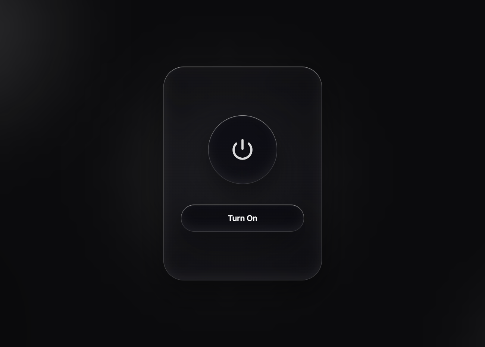

# Brutal Awake

[](https://github.com/vishalx0707/brutal-awake/releases/latest/download/BrutalAwake.exe)

A minimal Windows desktop app that keeps your laptop awake — overriding every sleep and display-timeout setting, and keeping it running **even when the lid is closed** — behind a single on/off button.

The interface is built with Apple's **Liquid Glass** material (real edge refraction, not just a blur) and genuine **SF Pro** typography, rendered in a frameless Chromium app-window.



## Features

- **Blocks sleep no matter the settings.** Uses the Windows `SetThreadExecutionState` API (system + display + away-mode) and re-asserts it every 30 seconds, so it overrides whatever your power plan says.
- **Lid-close stays awake.** While ON, sets the lid-close action to *Do Nothing* (both battery and plugged-in) via `powercfg`, and **restores your original setting** on OFF or exit.
- **One-tap UI.** A single glass button toggles between *Turn On* and *Turn Off*.
- **Self-contained.** A single `BrutalAwake.exe` — the UI (`ui.html`) and the glass module (`liquid-glass.js`) are embedded as resources. No installer, no runtime downloads.

## How it works

`KeepAwake.cs` is the backend: a tiny local `HttpListener` server that serves the UI and exposes `/api/state`, `/api/toggle`, and `/api/quit`. On launch it opens the UI in an Edge/Chrome app-window (`--app`), so the full Liquid Glass refraction renders. Turning on/off calls the OS APIs above; closing the window restores your power settings and exits.

Changing the lid-close action requires administrator rights, so the app requests elevation on launch (one UAC prompt).

## Run

Download the latest **[BrutalAwake.exe](https://github.com/vishalx0707/brutal-awake/releases/latest/download/BrutalAwake.exe)** from the [Releases](https://github.com/vishalx0707/brutal-awake/releases) page, double-click it, and approve the UAC prompt.

## Build from source

Requires the .NET Framework C# compiler (ships with Windows) and Microsoft Edge or Chrome installed.

```powershell
& "C:\Windows\Microsoft.NET\Framework64\v4.0.30319\csc.exe" `
  /nologo /target:winexe /out:"BrutalAwake.exe" `
  /win32manifest:app.manifest `
  /res:ui.html,ui.html /res:liquid-glass.js,liquid-glass.js `
  KeepAwake.cs
```

## Files

| File | Purpose |
|------|---------|
| `KeepAwake.cs` | Backend: HTTP server, sleep-block, lid-close control |
| `ui.html` | Liquid Glass UI |
| `liquid-glass.js` | Apple-style refraction module ([deepika-builds/liquid-glass](https://github.com/deepika-builds/liquid-glass), MIT) |
| `app.manifest` | Requests administrator elevation |

The prebuilt `BrutalAwake.exe` is published on the [Releases](https://github.com/vishalx0707/brutal-awake/releases) page rather than tracked in the repo.

## Notes

- **Fonts:** The UI uses the `-apple-system` / `SF Pro Text` stack. On Apple devices this is genuine SF Pro; on Windows it uses SF Pro if installed, otherwise Segoe UI Variable. SF Pro is not redistributed here (Apple's license does not permit it).
- The full glass refraction renders in Chromium (Edge/Chrome). Other browsers fall back to a frosted blur.

## License

MIT
